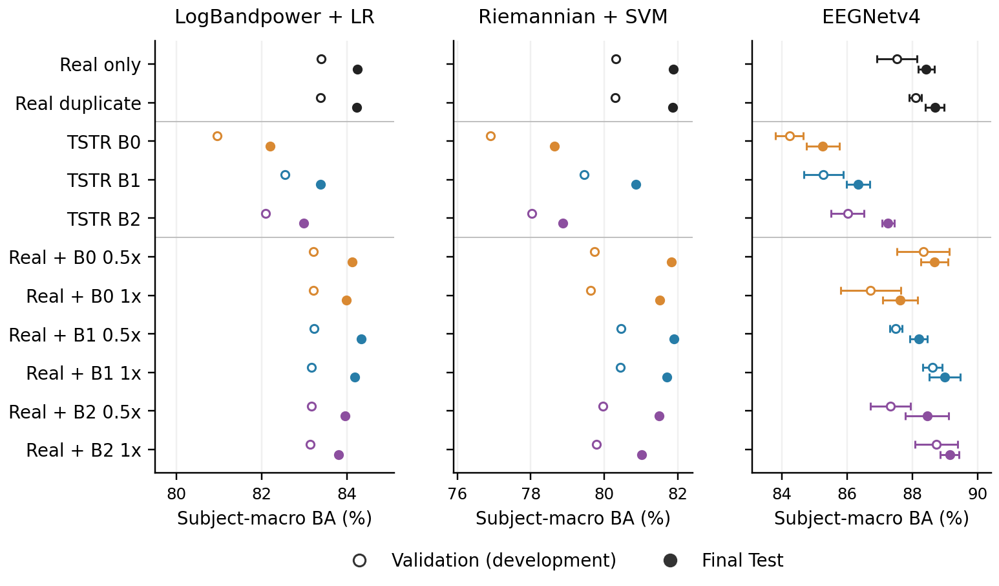

# Subject-Conditioned Resting-State EEG

Research code and preserved results for subject- and eye-state-conditioned diffusion models of MPI-LEMON resting EEG. The study asks whether synthetic EEG retains individual physiology and whether that fidelity translates into better classification of eyes-open versus eyes-closed recordings.

The completed comparison includes **198 participants**, three generators, three classifier families, and **11 training conditions**. Evaluation holds out complete recording blocks from the same participants; these results do not demonstrate generalization to new participants. The repository provides scientific source code, frozen provenance, aggregate result tables, figures, and a local presentation app.

The paper names **SC / SSC / SSC-C** correspond to the historical **B0 / B1 / B2** identifiers used in the code and saved outputs:

| Historical identifier | Paper name | Model and conditioning |
|---|---|---|
| B0 | SC | **State-conditioned diffusion model.** The only conditioning input is eye state. Subject IDs are used only to group sampling and evaluation; they are not inputs to the model. |
| B1 | SSC | **Subject-and-state-conditioned diffusion model.** A shared model conditioned on eye state and subject identity, initialized from B0 (SC). |
| B2 | SSC-C | **Validation-selected continuation of SSC.** Further training of B1 (SSC), with the same architecture and v-prediction objective, without an additional spectral loss (spectral-loss weight = 0). |

File names and result identifiers retain B0/B1/B2 for compatibility with the preserved code, outputs, and provenance. SC/SSC/SSC-C are the corresponding paper names, not additional models.

**Main finding:** full-dose B2 augmentation increased EEGNet subject-macro balanced accuracy from **88.417% to 89.135%** on held-out real Test blocks. The gain was **0.718 percentage points**, with a saved paired 95% subject-bootstrap interval of **[0.250, 1.201]**. B2 did not establish a clear advantage over B1, and full-dose B2 augmentation reduced performance for both classical classifiers. Utility therefore depended on the classifier.



The figure separates development Validation from Final Test. EEGNet error bars show population SD across three classifier seeds, not the subject-bootstrap confidence interval.

## Start here

- [Results](docs/RESULTS.md): all 11 conditions, paired comparisons, and fidelity findings.
- [Methods](docs/PUBLICATION_METHODS.md): data, preprocessing, generators, and evaluation.
- [Reproducibility](docs/REPRODUCIBILITY.md): what the public package supports and what requires the original research environment.
- [Pipeline map](docs/PIPELINE.md): how the historical scripts relate to the completed study.
- [Data availability](docs/DATA_AVAILABILITY.md) and [limitations](docs/LIMITATIONS.md).
- [EEG Synthetic Lab](apps/eeg_synthetic_lab/README.md): explore the prepared aggregate evidence locally.

The CSV tables and figures can be read directly without installing Python or obtaining EEG recordings. The presentation app uses a prepared aggregate bundle. Training and scientific evaluation are separate workflows that require external data and artifacts.

To launch the app from a suitable Python environment at the repository root:

```text
python -m pip install ".[app]"
python -m streamlit run apps/eeg_synthetic_lab/app.py
```

To redraw the saved result figures, see the [aggregate reproduction commands](docs/REPRODUCIBILITY.md#redraw-saved-aggregate-results).

## Study at a glance

| Item | Completed study |
|---|---|
| Dataset | MPI-LEMON resting-state EEG |
| Cohort | 198 included participants |
| Prediction target | Eyes open (EO) versus eyes closed (EC) |
| Split unit | Complete recording block; the same participants appear in every split |
| Blocks per participant and state | 5 Train / 1 Validation / 2 Test |
| Eligible windows | 47,835 Train / 9,635 Validation / 19,131 Test |
| Signal representation | 19 channels, 128 Hz, 4-second windows, 2-second stride |
| B0 = SC | Eye-state conditioning only; subject IDs group sampling and evaluation |
| B1 = SSC | Shared subject- and eye-state-conditioned model initialized from B0 (SC) |
| B2 = SSC-C | Validation-selected continuation of B1 (SSC); same architecture and v-prediction objective, spectral-loss weight = 0 |
| Utility classifiers | Log-bandpower + logistic regression; OAS/Riemannian + linear SVM; EEGNetv4-style network |
| Final utility design | 11 conditions; 55 fits; three EEGNet training seeds per condition |
| Primary utility metric | Balanced accuracy computed within each participant, then averaged equally over participants |

All three final generators use **v-prediction**. Historical files also describe earlier epsilon-prediction and spectral-loss candidates; those definitions do not describe all final selected models.

## Selected Final Test results

Balanced accuracy is in percent. EEGNet values are mean ± population SD across three seeds.

| Training condition | LogBP + LR | Riemann + SVM | EEGNet |
|---|---:|---:|---:|
| Real only | 84.246 | 81.878 | 88.417 ± 0.242 |
| Real duplicate | 84.230 | 81.868 | 88.682 ± 0.286 |
| Real + B1, 1× | 84.181 | 81.706 | 88.983 ± 0.468 |
| Real + B2, 1× | 83.809 | 81.016 | 89.135 ± 0.280 |

The [complete results table](docs/RESULTS.md) retains all doses, all TSTR conditions, and B0. The preserved [55-fit table](results/tables/utility_test_all_55_fits.csv) exposes the individual fits. Saved confidence intervals are unadjusted for multiple comparisons; they do not establish a universal augmentation benefit.

## Repository layout

```text
src/resting_eeg/       Original scientific package
scripts/              Original staged research scripts
configs/              Research configuration and path policy
tests/                Historical research tests
evidence/             Curated frozen records and saved scientific reports
results/tables/       Portable CSV extracts of completed results
results/figures/      Prepared scientific figures
apps/eeg_synthetic_lab/  Aggregate local presentation
docs/                 Publication documentation and retained historical material
```

The [evidence inventory](evidence/provenance/evidence_inventory.json) maps publication copies to their original paths and hashes. Original scientific source and selected evidence are preserved; historical absolute paths and phase-specific restrictions remain part of their provenance. The public package is not a claim that every historical experiment runs unchanged from a fresh clone.

## Interpretation and scope

This is a study of **new blocks from known participants**. Fidelity compares generated signals with Real Train; it is not an independent Test evaluation of generation. Model histories and development selection differ, so the comparison does not isolate a pure causal effect of subject conditioning. Fingerprint recovery and zero exact-copy detections do not establish a privacy guarantee. See the [full limitations](docs/LIMITATIONS.md).

No training, sampling, Final Test evaluation, bootstrap resampling, or historical test suite was rerun to prepare this publication repository. Reported values are preserved outcomes of the completed study.

## Citation

Repository: [salehmh10/subject-conditioned-resting-eeg](https://github.com/salehmh10/subject-conditioned-resting-eeg).

This is an initial public snapshot. Citation author metadata, `CITATION.cff`, and a formal archival release remain deferred at the maintainer's request. No software or paper DOI is asserted here. Until citation metadata is supplied, identify the repository URL and exact commit used. Cite the underlying [MPI-LEMON dataset publication, Babayan et al. (2019)](https://www.nature.com/articles/sdata2018308), and the applicable dataset distribution, separately when using its data.

## License

The original project code is licensed under the [MIT License](LICENSE).

Copyright (c) 2026 Saleh Mohammadhasani

MPI-LEMON data, dependencies, IEEE templates, and other third-party materials retain their own licenses and copyright notices; the project's MIT license does not relicense them. See [THIRD_PARTY_NOTICES.md](THIRD_PARTY_NOTICES.md) for scope and attribution.

See [CONTRIBUTING.md](CONTRIBUTING.md) for changes and [CHANGELOG.md](CHANGELOG.md) for the publication packaging history.
